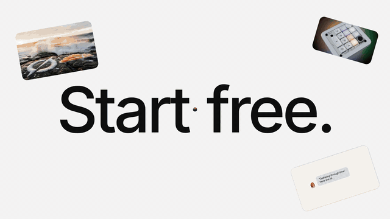
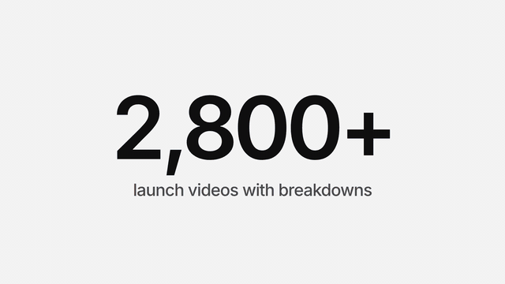
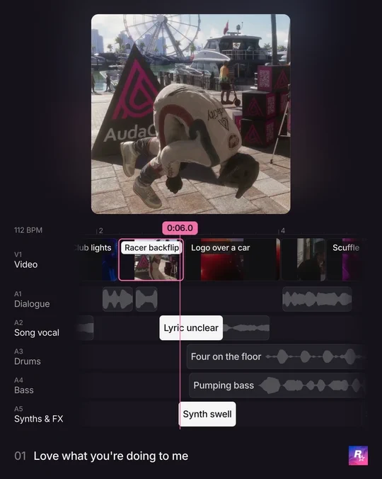

# posts.design MCP

<!-- This README is also published as claude-directory/README.md: link and embed files outside that folder (remake,
the sound breakdown, direction breakdowns) by their full github.com or raw.githubusercontent.com address. -->

Connect your agent to [posts.design](https://posts.design) and get back directions, examples and
breakdowns to nail your next post’s design. posts.design is a hand-picked gallery of real social
posts from top brands and their designers: launches, carousels, OG images and X headers.

<p>
  
  
</p>

Two launch films from the gallery, remade for posts.design with the [remake](https://github.com/posts-design/mcp/tree/main/skills/remake) skill.

[](https://posts.design/mcp)

- **Server URL:** `https://posts.design/mcp` (Streamable HTTP)
- **Sign-in:** OAuth with your posts.design account, or a personal key from
  [Settings → MCP](https://posts.design/settings?section=mcp)
- **Cost:** 100 credits a month on a free account, 1,000 with [Pro](https://posts.design/pricing). Video breakdowns and
  remakes come with Pro; a free account opens one film in full

## What you can ask for

| Ask your agent | You get |
|---|---|
| “Remake [posts.design video link] for [your product]” | That film rebuilt shot by shot with your words, logo, colours and fonts, rendered on your machine, in Claude Code ([examples](https://github.com/posts-design/mcp/tree/main/skills/remake)) |
| “Break down [posts.design video link]” | How the film is directed: the hook, timed beats, type, colour and end card, each tied to a still ([example](https://github.com/posts-design/mcp/tree/main/direction-breakdowns)) |
| “Find launch references for my invoicing app’s funding announcement” | The closest real launch posts, each credited, and a direction for yours |
| “How does Linear launch features?” | Its recurring patterns, what changed and what to borrow |
| “Plan a 30-second launch video for my app” | Beats with timings, type, colour and the end card, from real launch videos |
| “Make an OG image for this page” | A direction from real OG images, built in your project |
| “Make a sound breakdown of [film]” | The film over an editor’s timeline of itself, rendered on your machine, in Claude Code or with the kit ([example](https://github.com/posts-design/mcp/tree/main/breakdown)) |

## Set up

You need a free [posts.design](https://posts.design/signup) account.

**Claude** (claude.ai and the desktop app): open
[posts.design in Claude’s Connectors Directory](https://claude.ai/directory/connectors/posts-design),
click Connect, then sign in. Or add it yourself: Settings → Connectors → Add custom connector, paste
`https://posts.design/mcp`, then sign in.

**ChatGPT:** open [posts.design in ChatGPT’s plugins](https://chatgpt.com/plugins/plugin_asdk_app_6ae117b059408191a8852cd03e909e67),
install it, then sign in. Or add it yourself: Plugins → Add custom MCP server with OAuth, paste
`https://posts.design/mcp`, then install it and sign in.

**Claude Code:** install the plugin, which adds the server and its [skills](#skills):

```text
/plugin marketplace add posts-design/mcp
/plugin install posts-design@posts-design
```

Then run `/mcp`, choose posts.design and sign in. Then ask for anything in
[What you can ask for](#what-you-can-ask-for). If you added the server by hand before, remove it (`claude mcp remove posts`) so you sign in once.

For the server alone, add it yourself, with `--header "Authorization: Bearer <your-key>"` to use a personal key:

```bash
claude mcp add --transport http posts https://posts.design/mcp
```

**Antigravity:**

```bash
agy plugin install https://github.com/posts-design/mcp
```

Then sign in when Antigravity opens posts.design.

**Codex** (`~/.codex/config.toml`):

```toml
[mcp_servers.posts]
url = "https://posts.design/mcp"
http_headers = { Authorization = "Bearer <your-key>" }
```

**Skills in any other agent** (Cursor, Codex and more):

```bash
npx skills add posts-design/mcp
```

Add one skill with `--skill remake`. The skills use the server, so add `https://posts.design/mcp` to the
agent's MCP servers too and sign in.

**Cursor:** paste this link into your browser to add posts.design, then sign in when Cursor opens
posts.design:

```text
cursor://anysphere.cursor-deeplink/mcp/install?name=posts.design&config=eyJ1cmwiOiJodHRwczovL3Bvc3RzLmRlc2lnbi9tY3AifQ==
```

Or add it to `~/.cursor/mcp.json` with your personal key, or use **Add to Cursor** in Settings → MCP:

```json
{
  "mcpServers": {
    "posts": {
      "url": "https://posts.design/mcp",
      "headers": { "Authorization": "Bearer <your-key>" }
    }
  }
}
```

**Any other client:** add a remote Streamable HTTP server at `https://posts.design/mcp`. Clients
with OAuth sign in in the browser; others send `Authorization: Bearer <your-key>`.

Your personal key is in [Settings → MCP](https://posts.design/settings?section=mcp). Keep it
private; regenerating it there stops the old key working.

Once connected, ask your agent to call `get_my_access` to confirm.

## Tools

| Tool | Title | What it does | Plan |
|---|---|---|---|
| `search_references` | Search references | Search the published library by what you’re making: a launch video, a hiring post, an OG image. Filters by format, category, style, colour and brand | Free |
| `get_reference` | Get reference | Open one post, OG image or X header: attribution, dates, classification and all its media links, plus a video’s stills at its shot changes | Free |
| `search_saved_references` | Search saves | Search or list everything you’ve saved on posts.design | Free |
| `get_saved_reference` | Get saved reference | Open one saved reference with all its assets | Free |
| `get_saved_asset` | Get saved asset | Read one asset of a saved reference, with a preview image when one fits | Free |
| `save_reference` | Save reference | Save a post, OG image or X header to your Saves, when you ask | Free |
| `unsave_reference` | Remove from Saves | Remove one reference from your Saves, when you ask | Free |
| `get_my_access` | My access and credits | Show what this connection may read and how many credits are left | Free |
| `list_playbooks` | List launch playbooks | List the formats for a launch film or a raise announcement, with when to use each and its runtime | Free |
| `get_video_breakdown` | Video breakdown | How a video is directed: structure, hook, timed beats, type, colour, end card and what to borrow, each tied to a still ([example](https://github.com/posts-design/mcp/tree/main/direction-breakdowns)) | Pro |
| `get_video_scenes` | Video scenes | Every scene of a video with its time range, stills and the beats over it | Pro |
| `get_scene_frames` | Scene frames | Stills across one scene, as images in time order | Pro |
| `get_scene_clip` | Scene clip | A short silent MP4 of one scene, as a link that expires in an hour | Pro |
| `get_playbook` | Get launch playbook | One launch format in full: a beat sheet with timings, checks and real launches to study | Pro |

On a free account, one film opens in full with the four video tools, the first one you read; other films and `get_playbook` reply with what is ready (a film’s beats and scenes, a playbook’s beats, hooks and checks, as counts) and a link to Pro instead of answering, and use no credits.

**Credits:** one credit is one request: a search, a page of results, a post, a breakdown or a saved
item. Repeating a request, a failed request and `get_my_access` are free, and downloading media or
stills from returned links never uses credits. Credits reset on the 1st of each month (UTC).

## Prompts

Three starter prompts walk your agent through a first task. In Claude, open **+** in the chat box and
choose posts.design; in Claude Code they appear as slash commands under the server’s name. Choosing one is free; the
reads it makes use credits as usual.

| Prompt | You give | You get |
|---|---|---|
| `launch_references` | Your product, and what you’re launching | The closest launch posts and a direction for yours |
| `competitor_audit` | A brand | Its launches: recurring patterns, what changed, what to borrow |
| `launch_video_direction` | Your product, and a length | A beat-by-beat plan for a launch video, from real ones |

## Skills

The Claude Code plugin brings eleven skills. Each one takes your agent from a request to a finished result, using the
server for references. Your agent picks one when your request fits, or run it yourself as a slash command, such as
`/posts-design:launch-brief`. In other agents, copy a skill’s folder into your agent’s skills. With the plugin, you
don’t need the starter prompts above: the first three skills are fuller versions of them.

| Skill | Ask for | You get | With [Pro](https://posts.design/pricing) |
|---|---|---|---|
| [launch-references](skills/launch-references/SKILL.md) | Examples for your launch post | The closest launch posts and a direction for yours | 10× the credits, for wider searches |
| [competitor-audit](skills/competitor-audit/SKILL.md) | How a brand launches | Its recurring patterns, what changed, what to borrow | How each of the brand’s videos is directed, beat by beat |
| [launch-video-direction](skills/launch-video-direction/SKILL.md) | A plan for your launch video | Beats with timings, type, colour and the end card, from real launch videos | A full launch playbook, and the closest films broken down beat by beat |
| [launch-brief](skills/launch-brief/SKILL.md) | A brief from a one-line idea | One committed look, moves worth copying and numbered beats, each from a real launch | Exact moments from film breakdowns, scenes up close and a full playbook |
| [launch-copy](skills/launch-copy/SKILL.md) | The caption for your launch post | Three drafts shaped like real launch captions, or edits to yours | 10× the credits, for wider searches |
| [og-image](skills/og-image/SKILL.md) | A link preview image for a page | A direction from real OG images, built in your project | 10× the credits, for wider searches |
| [x-header](skills/x-header/SKILL.md) | An X profile header | A direction from real brand headers, made at 1500×500 | 10× the credits, for wider searches |
| [sound-breakdown](https://github.com/posts-design/mcp/blob/main/skills/sound-breakdown/SKILL.md) | A sound breakdown of a film you give it | The film over an editor’s timeline of itself, rendered on your machine | Scene times and beats for any film in the library |
| [layered-sound](https://github.com/posts-design/mcp/tree/main/skills/layered-sound) | Music for your film, from a track you hold the rights to | The track’s instruments entering and leaving with the story, with accents, mixed on your machine | The landing and the logo timed to a launch film you like |
| [remake](https://github.com/posts-design/mcp/tree/main/skills/remake) | A launch film like one you like, for your product | That film remade shot by shot in your brand, rendered on your machine | Any film in the library, not only your one free film |
| [rebuild](https://github.com/posts-design/mcp/tree/main/skills/rebuild) | Your own video as code | The same video rebuilt frame by frame in HTML, ready to edit its words, colours, size or language and render again | Nothing extra: it works on your own video |

For the best OG images and headers, run those skills in your project, or give your agent the brand’s font files, its
logo as SVG and a real screenshot of the product.

## What it can and can’t do

- It reads the published library and your own Saves, and changes your Saves only when you ask.
  It can’t post, publish or delete anything else. Sign-in asks for exactly that
  (`references:read`, `saved:read`, `saved:write`).
- Saving and removing are free, and each one is logged on your account.
- Results credit each post’s brand and author.

## Sound breakdown kit

[](https://github.com/posts-design/mcp/tree/main/breakdown)

[`breakdown/`](https://github.com/posts-design/mcp/tree/main/breakdown) turns any film you give it into a sound breakdown: the film plays over an editor’s
timeline of itself, with a filmstrip of its shots and one audio track per stem of its mix. Stems, words and shots
are measured on your machine (or by ElevenLabs with your own key) and the film renders without a browser. The
[sound-breakdown skill](https://github.com/posts-design/mcp/blob/main/skills/sound-breakdown/SKILL.md), part of the Claude Code plugin, walks an agent from the
film to the finished breakdown. MIT licensed, and provided
[as is](https://github.com/posts-design/mcp/blob/main/breakdown/README.md#licence).

## About this repository

It holds the server’s documentation, its [MCP Registry](https://registry.modelcontextprotocol.io) listing
(`design.posts/mcp`), its Claude Code, Antigravity and Cursor plugins, its [skills](#skills) and the open-source
[sound breakdown kit](#sound-breakdown-kit). The server itself is hosted by posts.design and is not open source.
More about it: [posts.design/mcp](https://posts.design/mcp).

## Help

Open an [issue](https://github.com/posts-design/mcp/issues).

Documentation, skills and the breakdown kit in this repository are MIT licensed; the posts.design name and
logo are not. The posts in the library belong to their authors.
