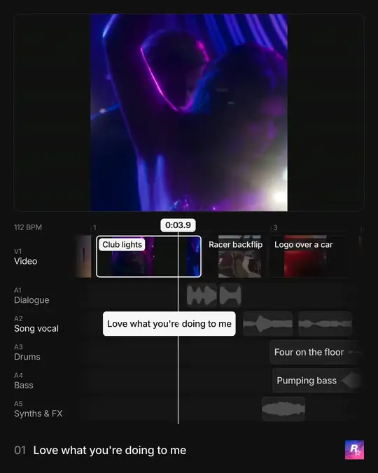

# Sound breakdown

This kit turns a film into a video of itself. The film plays above an editor's timeline: a filmstrip of its shots and
one audio track per stem of its mix (drums, bass, vocals…), each clip named for what you see and hear. It can end on a
wall of the brand's other posts.



*Eight seconds of a breakdown of Rockstar Games' GTA VI pre-loading post, made with this kit. Its
[spec](breakdown.example.json) is shown for its fields; the film, stems and posts it names are not included.*

The kit separates the stems, transcribes the words and finds the shots and tempo on your machine (or with ElevenLabs,
when you give it your key), then drafts a spec for you or your agent to name. It renders with Node, sharp and ffmpeg,
no browser. It was built at [posts.design](https://posts.design) for our own breakdowns and is free to use.

Use any film you're comfortable breaking down and posting. The layout is built for 16:9 films; a square or vertical
one plays as a narrower picture in the window. Breakdowns read best on a designed film with music cut to picture and a
few distinct layers, such as a launch film, product film or ad. UI recordings, voice-over alone and loops have less to
show.

## Quick start

You need:
- Node 20.9 or later;
- ffmpeg with libx264 and libmp3lame (it includes ffprobe);
- the [Inter](https://rsms.me/inter/) font;
- Python 3.10 or later for measuring (3.10 to 3.12 on Intel Macs, where Demucs needs an older PyTorch).

```bash
git clone https://github.com/posts-design/mcp && cd mcp/breakdown
npm install
python3 -m venv .venv
.venv/bin/pip install -r py/requirements.txt          # numpy, for measuring
.venv/bin/pip install -r py/requirements-demucs.txt --extra-index-url https://download.pytorch.org/whl/cpu   # stems
.venv/bin/pip install -r py/requirements-whisper.txt  # words: skip it with an ElevenLabs key or a film without vocals

node prep.mjs your-film.mp4 work/ --python .venv/bin/python   # drafts work/breakdown.json
# name the shots, clips and acts in work/breakdown.json (see Naming)
node render.mjs work/breakdown.json --stills 3,12,24   # writes work/breakdown-3.png, -12.png, -24.png
node render.mjs work/breakdown.json                    # writes work/breakdown.mp4
```

On four CPU cores, prep takes about 30 s for a 30 s film and the render about 70 s. The finished film plays yours up
to `pullBack`, then about 7.5 s of pull-back and end scene.

### What it downloads

Prep picks the lightest setup that fits the film and checks for each package before the step that needs it, saying
what to install. Sizes are for Linux; a Mac's PyTorch is smaller.

| Step | Default | Download | Lighter |
|---|---|---|---|
| Measuring | numpy | about 17 MB | |
| Stems | Demucs, with the CPU-only PyTorch | about 250 MB, and a 55 MB model on the first prep. Leave out the PyTorch index only on Linux with an NVIDIA GPU, for the CUDA build (about 3 GB). | `--stems elevenlabs` with your `ELEVENLABS_API_KEY`, or `--stems <folder>`: nothing |
| Words | none when the vocal stem is silent; ElevenLabs Scribe when `ELEVENLABS_API_KEY` is set; otherwise faster-whisper's `small` | faster-whisper about 130 MB, and the `small` model, about 490 MB, the first time it hears words (`--whisper-model large-v3-turbo` hears more: 1.6 GB) | the key, or `--words none`: nothing |

With an ElevenLabs key and `--stems elevenlabs`, numpy is all the Python you install. Rendering needs no Python; see
**Speed** below for its memory and cache.

## What prep makes

`prep.mjs` needs a film with its own sound. It writes into the folder:

| File | What it is for |
|---|---|
| `film.mp4` | a copy of the film, which the spec points at |
| `stems/` | the mix separated into drums, bass, vocals, guitar, piano and other |
| `prep/shots.jpg` | each candidate shot's middle frame with its number and start; "soft" marks a boundary found by a slower change (a whip pan, a match move) |
| `prep/stems.png` | every stem's spectrogram on one time axis, with the cuts over it |
| `prep/words.txt` | the words heard on the vocal stem with their times; `?` marks words to check by ear |
| `prep/words.json` | the same words as the transcriber gave them, which a rerun reuses; delete it to transcribe again |
| `prep/analysis.json` | the raw measurements: cuts, tempo, each stem's activity and loudness |
| `breakdown.json` | the draft spec: every shot, clip and act timed, with placeholder names |

Running prep again reuses `stems/` and `prep/words.json` and never overwrites `breakdown.json`. To redo the stems or
words with other options, delete them first. A folder holds one film; use a new one for the next.

## Naming

The draft is all placeholders, and naming is the real work. Render warns while any remain; clear them all before you
post.

1. **Shots.** Check `prep/shots.jpg`. Merge runs of false cuts from fast pans and strobes, and add motion transitions
   the detector missed (step through suspect stretches frame by frame). A camera move that never cuts is one shot: V1
   shows edits, not camera moves. Name each shot in two or three words for what it shows. Add a `transitions` tab only
   where the frames show a dissolve or wipe.
2. **Acts.** Group the shots into 5 to 10 acts, named from the film's own on-screen words where it has them. The
   footer shows the playing act, numbered.
3. **Tracks.** Listen to each stem against the picture with `prep/stems.png` open. Keep the four or five stems that
   carry something, rename them for a listener (Drums, Bass, Synths & FX), and merge or split the drafted clips. Name
   each clip by what it is ("Slide synth", "Hit", "Room tone"). Separators misfile sounds, so label by sound, not by
   stem: a clip's optional fourth value names the stem that holds it, `[start, end, label, stem]`. Drop what you
   can't hear on a phone.
4. **Words.** The vocal clips start out as the heard phrases, with "Words?" where the stem sounds but nothing was
   heard. Whisper hears speech and voice-over well and often misses sung lines: name those by ear, or "Lyric unclear".
   Never invent words or sounds.
5. **Tempo.** `bpm` and `barAnchor` come from the drum stem. If the song is edited to picture and bars don't hold
   across edits, switch the ruler to seconds rather than guessing bar numbers.
6. **Check.** Render stills across every act, read the clip labels at phone size, then watch the film once in real
   time.

## Options

| Option | How |
|---|---|
| **Aspect** | `"aspect": "4:5"` (1080 × 1350, the default) or `"9:16"`, the same frame on a 1080 × 1920 ground for Reels, TikTok and Shorts. |
| **Stem source** | `prep.mjs --stems demucs` (the default: [Demucs](https://github.com/facebookresearch/demucs) on your machine), `--stems elevenlabs` (ElevenLabs stem separation with your own `ELEVENLABS_API_KEY`), or `--stems <folder>` for stems you already have (`drums.wav`, `vocals.mp3`…; name one `vocals` to get words). |
| **Words** | `--words auto` (the default: none when the vocal stem is silent, Scribe when `ELEVENLABS_API_KEY` is set, otherwise whisper), `--words whisper` ([faster-whisper](https://github.com/SYSTRAN/faster-whisper)'s `small` on your machine, even with a key; `--whisper-model large-v3-turbo` hears more), `--words elevenlabs` (Scribe with your key, better at sung lines), or `--words none`. `--language en` when whisper guesses the language wrong. |
| **Tracks** | Up to six lanes, each `{ "name", "stem", "clips" }`. Four or five read best on a phone. Two lanes may draw the same stem. |
| **Dialogue and Song vocal** | When a film has both a song with vocals and spoken lines, give them two lanes from the same vocal stem: `Dialogue` (characters, a phone or PA, the announcer as `VO:`) and `Song vocal`. Split by what each line is. |
| **Ruler** | `"ruler": "bars"` (the default: bar numbers and beat ticks from `bpm` and `barAnchor`) or `"seconds"` (for songs edited to picture; `bpm` is then optional). |
| **Excerpt** | For networks that cap a video at 60 s: `node excerpt.mjs work/breakdown.json cut/ --from 36.9 --pull 75 --to 82`, in seconds of the full film, writes `cut/` with its own trimmed film, stems and spec. Start on an edit and a line. Pull back at most 52 s after `--from`, which leaves room for the end scene. The sound runs on to `--to` under the end scene and fades over the last `--fade` seconds (default 1.2). |
| **End scene** | `"end": { "line": ["Every Acme post,", "in one place."], "posts": [...] }`: at least 3 of the brand's other videos, and 7 to 12 fill the wall best. Each is a file, a link (downloaded when you render) or `[file or link, from]`. A tile plays 8 s, from 1 s in unless you give `from`; render warns about short or dark ones. The scene starts at `pullBack` + 1.5 s + `hold`. Leave `end` out and the film ends on the whole film. |
| **Brand mark** | `prep.mjs --avatar logo.png`, or `"avatar"` in the spec, shows the brand's mark bottom right. `"markKey": "white"` turns a black mark on white into a white mark; the default, `"black"`, keys a colour mark off black. |
| **Loudness** | The film's own mix, limited to −1.5 dBTP. Render prints the loudness and suggests `"gainDb"` (−24 to 12) when the mix is louder than −15 LUFS. |
| **Speed** | `render.mjs --jobs 4` renders on four processes (each needs about 2 GB of memory); the film is the same whatever the number. Decoded frames and render scratch go to `~/.cache/sound-breakdown` (`~/Library/Caches` on a Mac; `--cache <dir>` to move them). They take a few GB per minute of film; delete the folder whenever you like. |

## Spec reference

Paths are relative to the spec's folder. Times are seconds in the film. Render checks the spec first and lists every
problem at once, then checks that the film, every stem a lane draws and the end scene's posts are there before it
decodes anything.

| Field | Meaning |
|---|---|
| `source` | the film |
| `stems` | the folder of stems, one audio file per stem, named by stem |
| `cover` | the second shown as frame 0, the thumbnail: a settled, busy moment |
| `bpm`, `barAnchor` | tempo (needed with the bar ruler), and a second a bar starts on |
| `ruler` | `bars` (default) or `seconds` |
| `shots` | `[[start, end, name], …]`, the V1 filmstrip |
| `transitions` | seconds where a dissolve or wipe tab sits over an edit |
| `lanes` | `[{ name, stem, clips: [[start, end, label, stem?], …] }, …]`, one audio track each |
| `acts` | `[{ start, title }, …]`, the footer's numbered acts |
| `pullBack`, `hold` | when the timeline pulls back to the whole film (before its own end card or legal text), and how long that holds (default 1.2 s) |
| `end` | `{ line: [one or two lines], posts: [at least 3] }`, the end scene |
| `avatar`, `markKey` | the brand's mark, and `black` or `white` keying |
| `gainDb` | dB on the film's mix before the limiter |
| `aspect` | `4:5` (default) or `9:16` |
| `url`, `_note`, `_…` | anything for your own records |

## With posts.design

When the film is in the [posts.design](https://posts.design) library, the [posts.design MCP](../README.md) gives
your agent a head start. `get_video_scenes` lists its scenes with times, a shot list to check against
`prep/shots.jpg`, and `get_video_breakdown` names its beats, which are acts in waiting; both come with Pro.
`search_references` with `brand` and `format: "video"` lists the brand's other videos for the end scene: put the
`video.url` of those whose `video.role` is `analysis` into `end.posts`, leaving out the film itself.

To have an agent do all of this, copy the [sound-breakdown skill](../skills/sound-breakdown/SKILL.md) into your
agent's skills (`cp -r skills/sound-breakdown ~/.claude/skills/` for Claude Code).

## How it's built

| File | Job |
|---|---|
| `prep.mjs` | stems, words, measurements, sheets and the draft spec |
| `render.mjs` | spec to stills or film, and the sound |
| `excerpt.mjs` | a shorter spec from a stretch of the film |
| `lib/spec.mjs`, `lib/draft.mjs`, `lib/excerpt.mjs` | reading and checking a spec; drafting one; cutting one down |
| `lib/timing.mjs`, `lib/layout.mjs` | the film's clock and geometry, as pure functions |
| `lib/timeline.mjs` | the editor's timeline as SVG: ruler, filmstrip, waveform clips, playhead, acts |
| `lib/end-scene.mjs`, `lib/marquee.mjs`, `lib/streak.mjs` | the streak out of the film and the wall of posts |
| `lib/film.mjs`, `lib/encode.mjs`, `lib/media.mjs` | a frame from a time; frames to H.264 on several processes; ffmpeg reads |
| `py/analyse.py`, `py/words.py` | shot, tempo and stem measurement; local transcription |

Each frame is one SVG drawn from its time alone and rasterised by sharp, so frames can render in any order on
several processes and still give the same film, byte for byte, for a given sharp and ffmpeg. `npm test` checks the
spec, timing, layout, draft, excerpt, end-scene and render-split logic, and that `package.json`'s `files` lists
everything the kit needs. A script can import `render()` from `render.mjs`; its one drawing hook, `lockup`, draws a
mark under the end scene's wall (posts.design draws its own lockup there; this kit draws none).

## Licence

MIT. This is free tooling, provided as is: you answer for the films you break down and the breakdowns you post.
