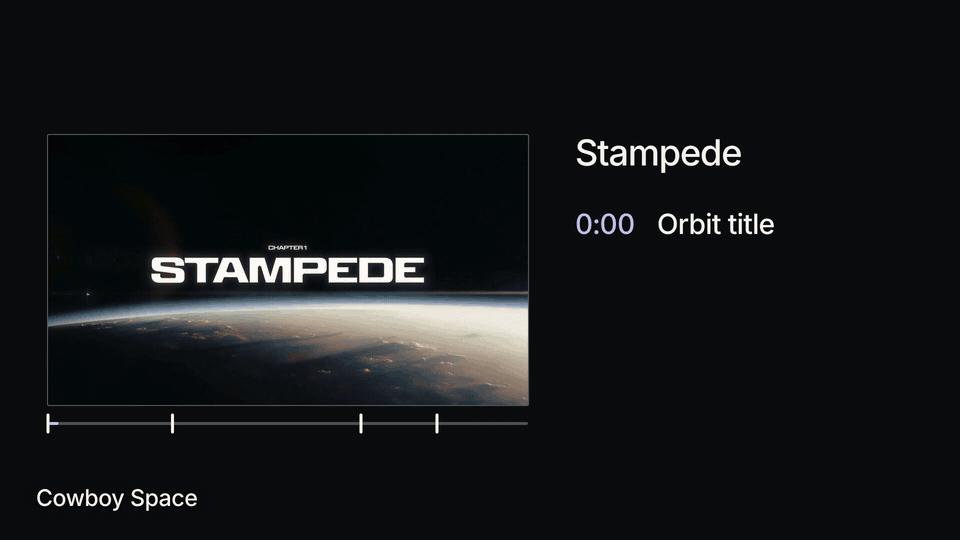

# Direction breakdowns

<p>
  
</p>

Cowboy Space Corp.’s Stampede launch film, read by an agent from posts.design.

Ask your agent how a launch video in the [posts.design](https://posts.design) gallery is directed, and it reads the
film’s breakdown: the structure, the hook, every beat with its timing and on-screen text, the type, the colour, the
end card and ideas worth borrowing, each tied to a still from the film. Then it can open any scene, its stills a
quarter second apart, or a short clip of it.

## Start

Connect posts.design to Claude, ChatGPT, Claude Code or any MCP client: [posts.design/mcp](https://posts.design/mcp)
has the steps. Then ask:

```text
Break down [posts.design video link]
```

No video in mind? Ask for launch videos like the one you’re making, and pick one.

## What you get

From [Stampede’s breakdown](https://posts.design/cowboy-space-corp-chapter-1-introducing-stampede-2026-10-27),
shortened:

- **Summary:** 27.2 s, 16:9, 5 scenes, a change every 5.4 s.
- **Hook:** “A bright title lands on a nearly black frame in the first half second, and a small object at the frame edge
  grows into a satellite, so the eye has a thing to follow.”
- **Beats:** hook 0–7.0 s, claim 7.0–15.4 s (“20,000 SATELLITES”), feature 15.4–17.7 s (“BIG IRON”), reveal 17.7–22 s,
  brand 22–27.2 s, each with what is on screen and the stills it rests on.
- **Type:** “Title: extra-wide heavy grotesk, all caps, white, centred, cap height about 10% of frame height.”
- **End card:** “A cream running-horse silhouette centred inside a thick circular ring on black, no text.”
- **Borrow:** “Reveal the hero object as a thin orange wireframe at about 8% of frame width, swap to the solid render in
  the same pose within about 0.6 s, then scale it up over about 2 s.”
- **Uncertainty:** the stretches no still covers, so your agent opens those scenes before describing them.

## Cost

On a free account, the first film you read opens in full: its breakdown, scenes, stills and clips. Other films come
with [Pro](https://posts.design/pricing). A breakdown is one credit.

The tools are `get_video_breakdown`, `get_video_scenes`, `get_scene_frames` and `get_scene_clip`; the
[README](../README.md#tools) lists them all.
