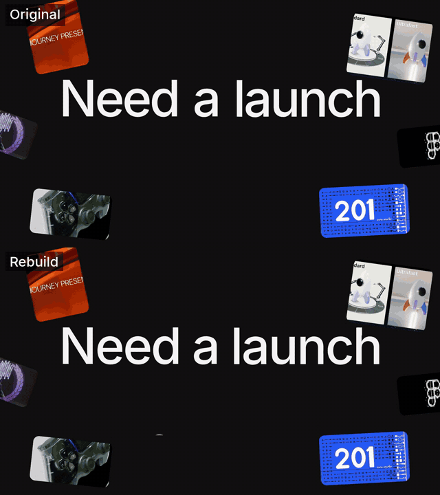

# Rebuild

<p>
  
</p>

Our own launch film (top) and its rebuild in code (bottom): 0.98 similar, frame by frame.

Turn a video you made into code you can edit. Your agent in Claude Code rebuilds it frame by frame: the type, shapes,
interface, logos and motion in HTML, the sound as it was. Then change a word, a colour, the size or the language,
and render it again. It works best on videos made of graphics.

## Start

You need [Claude Code](https://claude.com/product/claude-code).

```text
/plugin marketplace add posts-design/mcp
/plugin install posts-design@posts-design
```

Then ask:

```text
Rebuild [your video file] as code
```

If you have your logo, fonts and images, say where they are.

## What happens

1. Your agent measures your video: its size and frame rate, every cut and every move, to the frame.
2. It writes a shot list, then builds each shot in HTML with [HyperFrames](https://github.com/heygen-com/hyperframes),
   using your own files where you have them. Footage and playing videos inside the frame are cut from your video.
3. It renders the rebuild, scores every frame against your video, and fixes what's off.
4. You get the project, its similarity score, and which file holds the words, colours and timing.

Rebuild only videos you made or have the right to use. To make a new film for your product after one you like,
use [remake](../remake).

## Needs on your machine

Node.js 22 or later and FFmpeg. HyperFrames downloads a headless Chrome on its first render; your agent tells you
what it will install and asks first.

The skill itself is [SKILL.md](SKILL.md).
