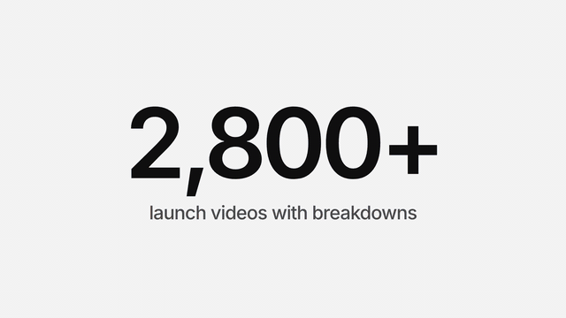

# Remake

<p>
  
  
</p>
<p>
  
</p>

Three remakes we made for posts.design.

Find a launch video you like in the [posts.design](https://posts.design) gallery and remake it for your own product
and use case. Your agent in Claude Code rebuilds the video scene by scene, with the same layout, moves and timing, and
with your words, product, logo, colours and fonts. The film renders on your machine.

## Start

You need [Claude Code](https://claude.com/product/claude-code) and a [posts.design](https://posts.design/signup) account.

```text
/plugin marketplace add posts-design/mcp
/plugin install posts-design@posts-design
```

Then run `/mcp`, choose posts.design and sign in, and ask:

```text
Remake [video link] for [your product]
```

No video in mind? Ask for launch videos that fit your product, and pick one.

## What happens

1. Your agent reads the video's scenes and stills from posts.design and writes a beat list: what is on screen in each
   moment, and what it becomes for your product.
2. It builds the film in HTML with [HyperFrames](https://github.com/heygen-com/hyperframes) in your brand, using only
   the facts you give it. It never uses the original's logo, copy or footage.
3. It renders the film, compares it with the original frame by frame, and fixes what's off.
4. You get the film, its length beside the original's, and what it changed and why.

The film is silent; add music cut to its scene changes. A 30-second film uses about 15 to 25 posts.design credits.

## Needs on your machine

Node.js 22 or later and FFmpeg. HyperFrames downloads a headless Chrome on its first render; your agent tells you
what it will install and asks first.

The skill itself is [SKILL.md](SKILL.md).
